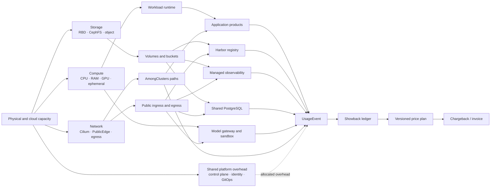

# RE8CH cluster consumability bifurcation

This document defines the boundary between cluster supply operations and tenant
consumption. It is a showback contract first: price curves can be attached only
after a resource has stable identity, isolation and replayable usage facts.

## Resource and expenditure flow

The join key across every branch is `service_instance_ref`. A Harbor pull, for
example, can produce registry request, Ceph read and cross-cluster egress facts;
those are separate UsageEvents linked to one service instance, not three unrelated
bills. `tenant_ref` identifies the consumer, while the administrative plugin that
observed or operated the resource remains supply-side provenance only.

## Snapshot assessment

The referenced live inventory contains 653 objects: 284 workloads (233
Deployments, 33 DaemonSets and 18 StatefulSets), 271 Services and 98 Ingresses.
Every namespace in that snapshot belongs to exactly one assessment class in
[`catalog.yaml`](catalog.yaml). Classification is deliberately namespace-wide
for complete coverage; product owners must narrow individual workload boundaries
before publishing a paid plan.

The September 3 observation also found:

- one configured Kubernetes context (`re8ch`) and 13 Kubernetes nodes;
- Harbor and Grafana healthy through their native service APIs;
- Ceph serving about 2.47 TiB available, but at `HEALTH_WARN` because two pools
  have no redundancy and two daemons recently crashed;
- Cilium at 12/13 ready agents, so network metering data is not yet complete;
- two Harbor RBD claims pending, while the active registry uses CephFS;
- Pigsty observation failed because `pg_isready` was absent on the selected
  node, so database meter readiness is unverified;
- a stale `regional-routing-discovery` route whose backend Service is missing.

These findings block production chargeback for the affected dimensions; they do
not block showback collection.

## What “Consumable” means

A workload being reachable is not enough. It becomes consumable only after all
publication gates in the catalog pass. Infrastructure controllers, exporters,
operators, credential brokers and admin MCP servers remain internal even when
they support a consumable service. Tenant plugins call tenant-safe facades and
receive only scoped service instances.

`Consumable` is also the normalization boundary for authorization. AI clients
operate only on `Tenant`, `Consumable`, `ConsumptionBinding` and an opaque
`accessRef`; adapters translate those declarations into Harbor projects and
robots, Grafana organizations/folders/datasources, Ceph claims, Cilium identities
and routes, PostgreSQL roles, LiteLLM teams or sandbox sessions. Native passwords,
tokens and application-specific ACL calls never cross the tenant MCP surface.

The only reserved tenant is `admin`, backed by the protected
`re8ch:tenant-admins` identity. Other DNS-label tenant names are created through
the same four generic operations: create tenant, create grant, update visibility
and delete tenant. Deletion revokes grants first and lets each adapter apply its
own retention policy.

Legacy implementation namespaces are never published as products. Existing
VictoriaMetrics, VictoriaLogs and Grafana data planes remain internal adapters;
hard-coded tenant proxies and example catalogs are removed only after generic
replacements satisfy their migration gates.

The first productization wave should be:

1. `registry.harbor.v1`, because tenant project and robot boundaries already exist;
2. `observability.managed.v1`, after tenant labels and retention meters are added;
3. volume and cross-cluster network classes, because they are dependencies of
   almost every other product;
4. PostgreSQL, model gateway and sandbox plans after their native spend/usage
   observations are verified.

## Metering gaps to close

The existing Birfucate collector covers Ceph capacity/I/O, Pigsty transactions,
public IP occupancy, Hubble flows and Hyperglass route branches. The catalog adds
the missing contract for workload compute, object storage, AmongClusters path
identity, Harbor actions, observability ingestion/retention, LiteLLM usage and
sandbox lifetime.

No price belongs in the collector. Collectors emit immutable quantities and raw
dimensions; versioned plans convert those facts into expenditure. Shared overhead
uses an explicit allocator (reserved capacity, proportional direct cost, or an
agreed fixed fee) and must never silently inflate a direct meter.
