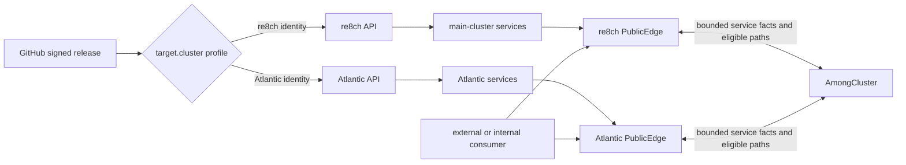

# Federated PublicEdge architecture

## Control plane and service plane

Cloud SSA, AmongCluster and PublicEdge solve different problems:

| Plane | Owns | Must not own |
| --- | --- | --- |
| Cloud SSA | Signed deployment to one explicit Kubernetes cluster; object inventory and field ownership | Cross-cluster service routing |
| AmongCluster | Reviewed service identity, endpoints, health, freshness, capacity and eligible paths | Kubernetes objects, credentials or remote cluster administration |
| PublicEdge | Stable hostname, TLS/listeners, regional selection and forwarding | Application desired state or another cluster's Nodes |

## Failure isolation

- A cluster keeps serving local endpoints when AmongCluster or another cluster
  is unavailable.
- A failed PublicEdge candidate is withdrawn without changing workload
  placement or Kubernetes ownership.
- A Cloud SSA transport failure blocks writes only to its target cluster; it
  must not silently redirect the bundle to a different cluster.
- Each cluster has independent CA, OIDC audience, protected Environment, RBAC,
  state ConfigMaps and endpoint candidates.
- Health signals remain separate: workload, listener, public reachability,
  backend, registry and cross-cluster path health are not one readiness bit.

## Endpoint selection

The main cluster's stable API transport is
`https://kube-api.service.re8ch.com`; its PublicEdge implementation may select
multiple regional authorities. Temporary hostnames and reviewed raw IPs are
fallback transports with matching TLS identities.

Atlantic has its own API transport. Its application services may still be
published under stable PublicEdge names and consumed from `re8ch`. This service
reachability does not make Atlantic a child API of the main cluster.

## Adding a cluster

1. Establish the independent Kubernetes API and CA.
2. Configure a cluster-specific GitHub Environment, OIDC audience and bounded
   RBAC identity.
3. Add ordered endpoint candidates and TLS identities to the reviewed execution
   profile.
4. Prove a dry-run and a small exact-object release directly against the new
   cluster.
5. Add a cluster-specific replay identity before enabling scheduled reconcile.
6. Deploy its local PublicEdge and AmongCluster agent.
7. Publish only the service contracts required by consumers.

Do not add a generic cluster-admin credential, tunnel all APIs through `re8ch`,
or treat AmongCluster registration as deployment authorization.
