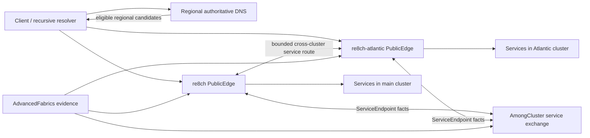

# Federated PublicEdge architecture

Status: target architecture, accepted for implementation; not all components
are deployed. See the dated [handoff](publicedge-amongcluster-handoff-2026-11-22.md)
for current runtime facts.

## Model

PublicEdge is a per-cluster data plane. AmongCluster is a service-federation
control plane. AdvancedFabrics supplies path and eligibility evidence. DNS is
one projection of that shared endpoint model, not the source of truth.



## Ownership rules

Each cluster owns:

- its Kubernetes Nodes, probes, Gateway/listeners, and PublicEdge workloads;
- its locally reachable service backends;
- its local DNS authority process and source-aware response map;
- local health, capacity, and admission decisions;
- the final decision to accept or drop traffic.

AmongCluster owns exchange of reviewed service facts:

- stable service identity;
- protocol and port;
- endpoint identity and locality;
- advertised ingress capability;
- observed health and freshness;
- capacity window and traffic budget;
- path class supplied by AdvancedFabrics;
- expiry and provenance.

AmongCluster must not exchange:

- remote Node objects as if they were local;
- kubelet or broad Kubernetes credentials;
- unrestricted cluster-admin access;
- a single global readiness bit that can unschedule every data-plane replica;
- unbounded probe schedules.

## Proposed ServiceEndpoint contract

The exact API may differ, but the semantics should remain small and explicit.

```yaml
apiVersion: amongcluster.re8ch.com/v1alpha1
kind: ServiceEndpoint
metadata:
  name: kube-api-us-west-la1
spec:
  serviceRef: kube-api
  ownerCluster: re8ch-atlantic
  locality:
    country: US
    region: us-west
    site: la1
  addresses:
    - protocol: tcp
      host: 179.255.126.104
      port: 443
  ingressClass: public-edge
  pathClass: amongcluster-private-transit
  trafficBudget:
    maxConcurrent: 200
    overflow: drop
  expiresAfter: 120s
status:
  healthy: true
  observedAt: "<RFC3339>"
  source: public-edge/re8ch-atlantic
```

Consumers must reject stale, unsigned/untrusted, unsupported-protocol, closed
capacity, or unhealthy candidates. The endpoint owner can withdraw a candidate
without modifying the consuming cluster's Nodes.

## Service request path

For `kube-api.service.re8ch.com`:

1. A regional authoritative DNS instance receives a query.
2. It determines a source area using ECS when trustworthy, otherwise the
   recursive resolver's address.
3. It filters the current candidate set by service health, freshness, capacity,
   listener readiness, and policy.
4. It ranks eligible candidates using the local response map.
5. It returns a small answer set with a default fallback.
6. The selected PublicEdge listener terminates or passes through the required
   protocol and forwards locally or across the bounded AmongCluster path.
7. Overload is rejected or dropped according to the service contract; it does
   not trigger uncontrolled retries or probes.

The same abstraction serves auth, Headlamp, database, mail, SubAccess, and
future services, but each protocol requires its own end-to-end health check.

## Regional response maps

The response map is not a binary “China versus overseas” switch. It is an
ordered policy over all healthy candidates.

| Query area | Preferred candidates | Later fallback |
| --- | --- | --- |
| CN | R640 and other CN PublicEdge points | nearest healthy overseas candidates |
| US West | LA1, LA2 | FLK, Helsinki, KL, then CN |
| EU central | FLK | Helsinki, LA, KL, then CN |
| EU north | Helsinki | FLK, LA, KL, then CN |
| SEA | KL | LA, Helsinki/FLK, then CN |
| Unknown | globally healthy low-risk default | remaining healthy candidates |

The Atlantic cluster should own LA1, LA2, FLK, Helsinki, and KL candidates.
The main cluster should own R640 and other CN candidates. A candidate can be
visible globally without being equally preferred everywhere.

## Independent state machines

These states must never be collapsed into one label:

| State | Meaning | May affect |
| --- | --- | --- |
| Workload placement | Where the PublicEdge process is allowed to run | scheduler only |
| Listener readiness | Whether 53/443 is actually accepting traffic | candidate eligibility |
| External authority reachability | Whether the public Internet reaches an authority | delegation/answer eligibility |
| Backend health | Whether the target service works through the edge | per-service candidate eligibility |
| Registry reachability | Whether nodes can fetch artifacts | rollout, not serving eligibility |
| Path health | Whether a local/cross-cluster route is usable | ranking and admission |

Failure of one external authority must not evict the process that could repair
or observe it. Likewise, a healthy pod is not evidence that public 53 works.

## Availability and load shedding

- Run at least two independent authority/data-plane failure domains per active
  region where the service requires 99.9% availability.
- Bound health probes; share fresh observations instead of every component
  probing every endpoint.
- Use explicit freshness and hysteresis to prevent DNS flapping.
- Keep at least one default answer for unmapped source addresses.
- Return small DNS answer sets and avoid unnecessary CNAME chains.
- Prefer deterministic admission and load shedding over retry storms.
- A cluster must keep serving its local endpoints if AmongCluster or the other
  cluster control plane is unavailable.

## GitOps and release flow

1. Change product source in `public-edge/public-edge-manager`.
2. Test rendering and behavior, including a multi-node placement case.
3. Publish image/chart once and record immutable digests and provenance.
4. Change only the references and intended values in
   `pillars-infra/network-gitops` through a signed PR.
5. Run protected static release with publish or exact reuse and execution.
6. Verify accepted/applied digest equality and SSA ownership.
7. Verify the live service externally from every policy area.

Normal reconciliation cannot invent an accepted static-release state. A
protected execution is part of delivery, not an optional repair step.
